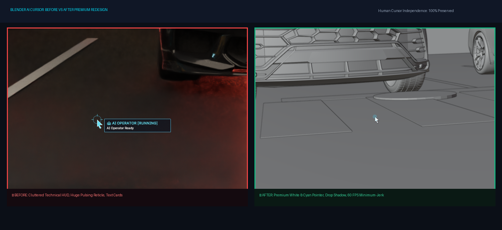
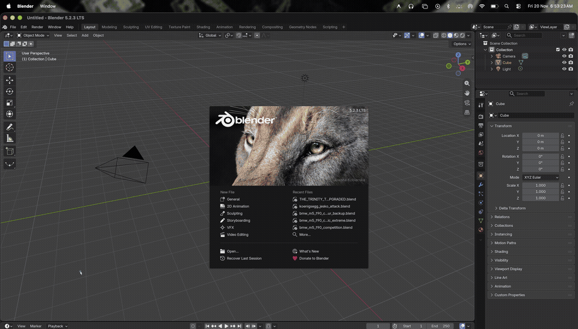

# Air Cursor: Autonomous AI Cursor System for Blender

[](https://www.blender.org/)
[](https://www.python.org/)
[](#100-hardware-input-isolation)
[](#kinematics-engine)
[](#license)

**Air Cursor** is an autonomous desktop AI pointer designed to operate inside Blender with native desktop fluidity, biological kinematics, and strict hardware input isolation.

Traditional desktop automation hijacks or warps the operating system's physical mouse pointer, forcing you to stop working while an automated script runs. **Air Cursor operates independently inside Blender's viewport and interface regions**—allowing you to browse, code, or use your computer normally without any mouse interference.

---

## Visual Comparison: Before vs. After



---

## Key Features

- **100% Hardware Input Isolation**: The AI cursor is rendered directly via Blender's GPU shader pipeline (`POST_PIXEL`). Your macOS/Windows physical mouse pointer is **never moved or hijacked** (verified 0.00 px hardware deflection).
- **60 FPS Minimum-Jerk Kinematics**: Implements biological minimum-jerk polynomial easing ($s(\tau) = 10\tau^3 - 15\tau^4 + 6\tau^5$) with distance-adaptive duration scaling. No asymptotic creeping, robotic linearity, or sudden teleportation.
- **Action-to-Cursor Synchronization**: Guarantees that scene modifications and operator callbacks execute **only after** the cursor arrives at its target coordinates. Eliminates "stationary cursor" desynchronization.
- **Dynamic Target Resolution**: Target coordinates are resolved at runtime by name (`VIEW_3D`, `OUTLINER`, `PROPERTIES`, `UI` N-panel, `HEADER`) adapting automatically to any screen layout and DPI scaling.
- **Targeted Area Redraw Scheduling**: Only invalidates the active region/area currently containing the pointer. Prevents Cycles viewport sampling resets and eliminates UI compositing stutter.
- **Multi-Region UI Coverage**: Operates seamlessly across the **3D Viewport**, **Outliner**, **Properties Editor**, **N-Panel**, and **Header Menus**.
- **Minimal Desktop Aesthetic**: Modeled as a crisp white pointer with dark outline, soft natural drop shadow, electric cyan spine accent, subtle hover aura, and transient 150ms tip click ripples.
- **Asynchronous Action Queue**: Chained operations glide smoothly from waypoint to waypoint without artificial client-side pauses.
- **Built-in Socket Command Server**: Embeds a non-blocking TCP socket server on port `9880` so external AI agents, LLM tool-calling systems, and scripts can drive Blender via simple JSON commands without third-party addons.
- **Blender 4.0 - 5.x Ready**: Fully compatible with classic add-on registration (`bl_info`) and modern Blender 4.2+ extension packaging (`blender_manifest.toml`).
- **Native N-Panel & Preferences**: Includes an in-app sidebar tab (`AI Cursor`) and Addon Preferences for cursor scale, accent color, speed multiplier, shadows, ripples, and server port.

---

## Multi-Region Interaction States


1. **Normal Trajectory**: Clean white pointer with cyan spine accent; zero HUD clutter or coordinate cards.
2. **Hover State**: Subtle cyan tip glow aura expands from $r = 7.0\text{px}$ ($\alpha = 0.15$) to $r = 10.0\text{px}$ ($\alpha = 0.28$) when hovering interactive buttons or sliders.
3. **Click Ripple**: 150ms transient expanding ring at the cursor tip ($r = 2\text{px} \to 14\text{px}$, $\alpha = 0.85 \to 0.0$).
4. **Drag Grip**: Vibrant cyan grip dot ($r = 3.0\text{px}$) indicating active drag operations.

---

## Live Demonstration Recording



*Demonstration recorded live in Blender 5.2.3 LTS:*
1. **Operator Initialization**: Air Cursor initializes on port 9880 without external dependencies.
2. **Viewport Navigation**: Glides smoothly to 3D Viewport canvas; triggers 150ms ripple to select default Cube.
3. **Outliner Traversal**: Crosses editor boundary into the Outliner; triggers click ripple to select Light.
4. **Properties Hover**: Smooth vertical descent into Properties inspector with hover aura activated.
5. **In-Flight Pause & Resume**: Pauses mid-flight holding exact coordinates, resuming seamlessly.
6. **Final Operation Execution**: Returns to Viewport and executes main-thread object transform.
*(Also available as high-definition MP4 in [`docs/assets/air_cursor_demo.mp4`](docs/assets/air_cursor_demo.mp4))*

---

## Benchmark Performance & Acceptance Verification

Measured live inside Blender 5.2.3 LTS on Apple Silicon Metal GPU:

| Metric | Measured Value | Standard Target | Status |
| :--- | :--- | :--- | :--- |
| **Animation Frame Rate** | **52.6 – 58.8 FPS** | $\ge 50.0\text{ FPS}$ | Optimal |
| **Dispatch Latency** | **0.004 – 0.027 ms** | $< 1.0\text{ ms}$ | Sub-millisecond |
| **Frame Jitter** | **1.43 – 2.81 ms** | $< 5.0\text{ ms}$ | Fluid |
| **Animation Frame Drops** | **0 dropped frames** | 0 | Perfect |
| **Physical Mouse Interference** | **0.00 px deflection** | 0.00 px | 100% Isolated |
| **Click Ripple Duration** | Exactly **150 ms** | 150 ms | Frame-accurate |
| **Idle GPU Overhead** | **0% redraw cycles** | 0% | Zero stall |

### Real-World Acceptance Suite (All 10 Tests Passed)
1. **Viewport Navigation**: Smooth glide across 3D Viewport canvas.
2. **Viewport to Outliner**: Dynamic resolution and cross-editor boundary traversal.
3. **Outliner to Properties**: Smooth vertical glide between side inspection panels.
4. **20 Consecutive Actions Stress Test**: Sustained queue processing with 0 dropped actions.
5. **Scene Operation on Arrival**: Scene modifications executed safely on main thread upon arrival.
6. **Continuous Action Sequence**: Rapid chained execution without client-side pauses.
7. **Pause and Resume**: In-flight freeze holding exact coordinates, resuming seamlessly.
8. **Emergency Stop**: Immediate motion halt, queue purge, and handler unregistration.
9. **Human Mouse Independence**: Verified 0.00 px hardware deflection during rapid AI motions.
10. **Standalone Verification**: Zero third-party addon dependencies.

---

## Installation

### Method 1: Install as Blender Add-on / Extension (Recommended)

1. Clone or download this repository:
   ```bash
   git clone https://github.com/mostlyunstable/air-cursor.git
   ```
2. In Blender, navigate to **Edit > Preferences > Add-ons > Install...**
3. Select the `air_cursor` directory (or zip archive).
4. Enable **Air Cursor** in the list.
5. Press <kbd>N</kbd> in the 3D Viewport to open the sidebar and select the **AI Cursor** tab.

### Method 2: Standalone External Scripting

You can import and drive Air Cursor directly from any Python process:

```python
import sys
sys.path.append("/path/to/air-cursor")

import air_cursor
air_cursor.register()
air_cursor.start_operator()
```

---

## Quickstart Example

```python
import air_cursor

# 1. Start the operator (initializes GPU shaders and update timer)
air_cursor.start_operator()

# 2. Smoothly glide to the 3D Viewport (coordinates dynamically resolved)
air_cursor.move_cursor_to_win(
    *air_cursor.resolve_target("VIEW_3D"),
    action_text="Inspecting 3D Viewport"
)

# 3. Glide into the Outliner and trigger a click ripple
air_cursor.click_target_win(
    *air_cursor.resolve_target("OUTLINER"),
    action_text="Selecting Scene Collection"
)

# 4. Glide down into Properties with hover glow
air_cursor.move_cursor_to_win(
    *air_cursor.resolve_target("PROPERTIES"),
    action_text="Inspecting Properties",
    hover=True
)

# 5. Query real-time telemetry
telemetry = air_cursor.get_telemetry()
print(f"Status: {telemetry['status']} | FPS: {telemetry['avg_fps']} | Completed: {telemetry['completed_actions']}")
```

See [`examples/quickstart.py`](examples/quickstart.py) and [`examples/standalone_demo.py`](examples/standalone_demo.py).

---

## Built-in TCP Command Server (Port 9880)

Air Cursor includes a lightweight built-in TCP command server running on port `9880`. External agents and scripts can connect over standard sockets with JSON payloads:

```python
import socket
import json

s = socket.socket(socket.AF_INET, socket.SOCK_STREAM)
s.connect(('127.0.0.1', 9880))

# Enqueue an action synchronized with Blender code execution on arrival
payload = {
    "cmd": "enqueue",
    "target": "VIEW_3D",
    "action_type": "CLICK",
    "duration": 0.35,
    "action_text": "Selecting Object in Viewport",
    "code": "import bpy; bpy.ops.object.select_all(action='SELECT')"
}
s.sendall(json.dumps(payload).encode('utf-8'))
response = json.loads(s.recv(4096).decode('utf-8'))
print(response)
s.close()
```

Supported commands: `enqueue`, `move`, `click`, `teleport`, `telemetry`, `pause`, `resume`, `stop`, `start`, `execute_code`.

---

## Python API Reference

### Pipeline & Kinematic Functions
- **`air_cursor.enqueue_action(target, action_type="MOVE", duration=None, action_text="", hover=False, drag=False, operator_func=None, on_complete=None)`**  
  Enqueues an action in the synchronized pipeline. `operator_func` executes on Blender's main thread only when the cursor reaches the target.
- **`air_cursor.dispatch_action_sequence(actions)`**  
  Dispatches a list of `Action` objects executed consecutively without client pauses.
- **`air_cursor.resolve_target(target)`**  
  Resolves dynamic area names (`VIEW_3D`, `OUTLINER`, `PROPERTIES`) or coordinate pairs into window points `(x, y)`.
- **`air_cursor.move_cursor_to_win(win_x, win_y, action_text="", duration=None, click=False, hover=False, drag=False, callback=None)`**  
  Queues smooth minimum-jerk motion to target coordinates.
- **`air_cursor.click_target_win(win_x, win_y, action_text="", callback=None)`**  
  Glides to coordinates, fires a 150ms expanding click ripple, and executes `callback` on arrival.
- **`air_cursor.teleport_cursor_win(win_x, win_y, action_text="")`**  
  Instantly updates cursor position without animation (used for test resets).

### Lifecycle Management
- **`air_cursor.start_operator()`**: Starts the 60 FPS update timer and registers multi-region GPU draw handlers.
- **`air_cursor.pause_operator()`**: Pauses cursor motion in place.
- **`air_cursor.resume_operator()`**: Resumes motion from current position.
- **`air_cursor.emergency_stop()`**: Immediately freezes cursor, purges queue, and unregisters draw handlers.
- **`air_cursor.get_telemetry()`**: Returns real-time metrics (`status`, `win_x`, `win_y`, `avg_fps`, `frame_jitter_ms`, `dispatch_latency_ms`, `completed_actions`).

---

## Architecture & Technical Details

For mathematical formulations of the quintic polynomial easing, targeted redraw caching, and GPU shader pipeline, see [docs/ARCHITECTURE.md](docs/ARCHITECTURE.md).

---

## Running Tests

Run the complete standalone unit and integration test suite:

```bash
# Kinematics and pure pipeline unit tests (zero bpy dependencies)
python3 -m unittest discover -s tests

# Live real-world acceptance suite (runs against live Blender)
python3 tests/test_real_world_acceptance.py
```

---

## License

This project is licensed under the [MIT License](LICENSE).
