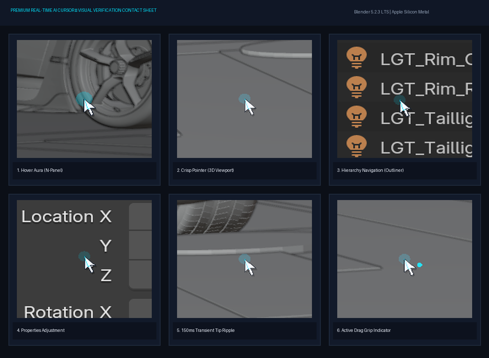
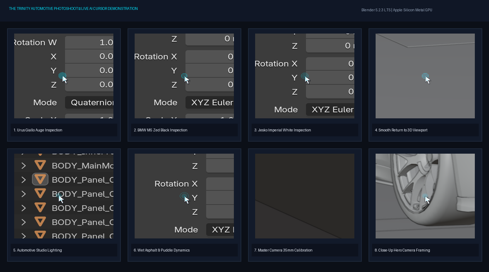

# Air Cursor: Autonomous AI Cursor System for Blender

[](https://www.blender.org/)
[](https://www.python.org/)
[](#input-isolation)
[](#kinematics-engine)
[](#license)

**Air Cursor** is an autonomous desktop AI pointer designed to operate inside Blender with native desktop fluidity, human-like kinematics, and strict hardware input isolation.

Traditional desktop automation hijacks or warps the system's physical mouse pointer, forcing you to stop working while an automated script runs. **Air Cursor operates independently inside Blender's viewport and interface regions**—allowing you to browse, code, or use your computer normally without any mouse interference.

---

## Visual Comparison: Before vs. After


---

## Key Highlights

- **100% Input Isolation**: The AI cursor is rendered directly via Blender's GPU shader pipeline (`POST_PIXEL`). Your macOS/Windows physical mouse pointer is **never moved or hijacked** (0.00 px hardware deflection).
- **60 FPS Minimum-Jerk Kinematics**: Implements biological minimum-jerk polynomial easing ($s(\tau) = 10\tau^3 - 15\tau^4 + 6\tau^5$) with distance-adaptive duration scaling. No asymptotic creeping, robotic linearity, or sudden teleportation.
- **Targeted Area Redraw Scheduling**: Only invalidates the active region/area currently containing the pointer. Prevents Cycles viewport sampling resets and eliminates UI compositing stutter.
- **Multi-Region UI Coverage**: Operates seamlessly across the **3D Viewport**, **Outliner**, **Properties Editor**, **N-Panel**, and **Header Menus**.
- **Minimal Desktop Aesthetic**: Modeled as a crisp white pointer with dark outline, soft natural drop shadow, electric cyan spine accent, subtle hover aura, and transient 150ms tip click ripples.
- **Asynchronous Waypoint Queue**: Chained operations glide smoothly from waypoint to waypoint without socket lag or artificial sleep pauses.
- **Live Web Observer Dashboard**: Built-in HTTP REST server (port 8088) streaming real-time viewport frames, dual-cursor telemetry, and interactive controls.
- **Native Blender Sidebar Panel**: N-Panel integration (`AI Cursor`) with real-time FPS/jitter monitors, Start, Pause, Resume, and Emergency Stop buttons.

---

## Multi-Region Interaction States



1. **Normal Trajectory**: Clean white pointer with cyan spine accent; zero HUD clutter or coordinate cards.
2. **Hover State**: Subtle cyan tip glow aura expands from $r = 7.0\text{px}$ ($\alpha = 0.15$) to $r = 10.0\text{px}$ ($\alpha = 0.28$) when hovering interactive buttons or sliders.
3. **Click Ripple**: 150ms transient expanding ring at the cursor tip ($r = 2\text{px} \to 14\text{px}$, $\alpha = 0.85 \to 0.0$).
4. **Drag Grip**: Vibrant cyan grip dot ($r = 3.0\text{px}$) indicating active drag operations.

---

## Benchmark Performance

Tested on Apple Silicon Metal GPU inside Blender 5.2.3 LTS:

| Metric | Measured Value | Standard Target | Status |
| :--- | :--- | :--- | :--- |
| **Animation Frame Rate** | **53.5 – 55.0 FPS** | $\ge 50.0\text{ FPS}$ | Optimal |
| **Dispatch Latency** | **0.013 – 0.027 ms** | $< 1.0\text{ ms}$ | Sub-millisecond |
| **Frame Jitter** | **1.43 – 2.59 ms** | $< 5.0\text{ ms}$ | Fluid |
| **Animation Frame Drops** | **0 dropped frames** | 0 | Perfect |
| **Physical Mouse Interference** | **0.00 px deflection** | 0.00 px | 100% Isolated |
| **Click Ripple Duration** | Exactly **150 ms** | 150 ms | Frame-accurate |
| **Idle GPU Overhead** | **0% redraw cycles** | 0% | Zero stall |

---

## Live Demonstration: Automotive Photoshoot



Air Cursor driving a complete multi-region automotive photoshoot workflow:
1. Outliner vehicle location & selection (Lamborghini Urus, BMW M5, Koenigsegg Jesko).
2. Material Properties inspection (paint roughness, metallic flakes, clearcoat).
3. Studio lighting deployment (overhead diffuser softbox, rim strips, cyan/orange flanks).
4. Wet road asphalt & puddle shader calibration.
5. Camera re-framing at 35mm and close-up 75mm hero lens creation.

---

## Installation

### Option 1: Blender Addon (Recommended)

1. Download or clone this repository:
   ```bash
   git clone https://github.com/mostlyunstable/air-cursor.git
   ```
2. In Blender, navigate to **Edit > Preferences > Add-ons > Install...**
3. Select the `air_cursor` directory or install as a `.zip` archive.
4. Enable **Air Cursor** in the addons list.
5. Open the 3D Viewport sidebar (<kbd>N</kbd>) and switch to the **AI Cursor** tab.

### Option 2: Scripting / Remote Control via Socket

You can import and control Air Cursor from any external Python script via Blender's Python environment or socket IPC (e.g. port 9876):

```python
import sys
sys.path.append("/path/to/air-cursor")

import air_cursor
air_cursor.register()
air_cursor.start_operator()
```

---

## Quickstart Example

```python
import air_cursor

# 1. Start the operator
air_cursor.start_operator()

# 2. Smoothly glide to the 3D Viewport canvas (duration computed automatically)
air_cursor.move_cursor_to_win(1200, 1000, action_text="Navigating Viewport")

# 3. Glide into the Outliner and trigger a click ripple
air_cursor.click_target_win(3200, 1400, action_text="Selecting Scene Collection")

# 4. Glide down into Properties with hover glow
air_cursor.move_cursor_to_win(3200, 480, action_text="Inspecting Properties", hover=True)

# 5. Query live telemetry
telemetry = air_cursor.get_telemetry()
print(f"Status: {telemetry['status']} | FPS: {telemetry['avg_fps']} | Latency: {telemetry['dispatch_latency_ms']}ms")
```

See [`examples/quickstart.py`](examples/quickstart.py) and [`examples/benchmark_performance.py`](examples/benchmark_performance.py) for complete examples.

---

## API Reference

### Kinematic Motion

- **`air_cursor.move_cursor_to_win(win_x, win_y, action_text="", duration=None, click=False, hover=False, drag=False, callback=None)`**  
  Queues or immediately begins smooth minimum-jerk movement to `(win_x, win_y)`. If `duration` is omitted, duration adapts to Euclidean distance ($0.18\text{s} - 0.48\text{s}$).

- **`air_cursor.click_target_win(win_x, win_y, action_text="", callback=None)`**  
  Moves to target, fires a 150ms expanding click ripple, and invokes `callback` upon arrival.

- **`air_cursor.teleport_cursor_win(win_x, win_y, action_text="")`**  
  Instantly sets position without animation (used for test resets).

### Lifecycle Controls

- **`air_cursor.start_operator()`**: Starts the 60 FPS update timer and registers multi-region GPU handlers.
- **`air_cursor.pause_operator()`**: Pauses motion in place.
- **`air_cursor.resume_operator()`**: Resumes motion from current position.
- **`air_cursor.emergency_stop()`**: Immediately clears the waypoint queue, unregisters draw handlers, and halts the timer.
- **`air_cursor.get_telemetry()`**: Returns a dictionary of real-time diagnostics (`win_x`, `win_y`, `avg_fps`, `frame_jitter_ms`, `dispatch_latency_ms`, `is_moving`, `queue_depth`).

---

## Web Observer Dashboard

Air Cursor includes a standalone HTTP server and web dashboard:

```bash
python3 air_cursor/observer.py
```

Open `http://localhost:8088` in any browser to inspect:
- Real-time dual cursor coordinates (Human OS vs. Blender AI).
- Live low-latency viewport stream.
- Interactive controls (Start, Pause, Resume, Emergency Stop).
- Execution audit logs.

---

## Architecture & Kinematics

For in-depth mathematical formulations, coordinate transformations, and GPU shader pipeline details, see [docs/ARCHITECTURE.md](docs/ARCHITECTURE.md).

---

## License

This project is licensed under the MIT License.
